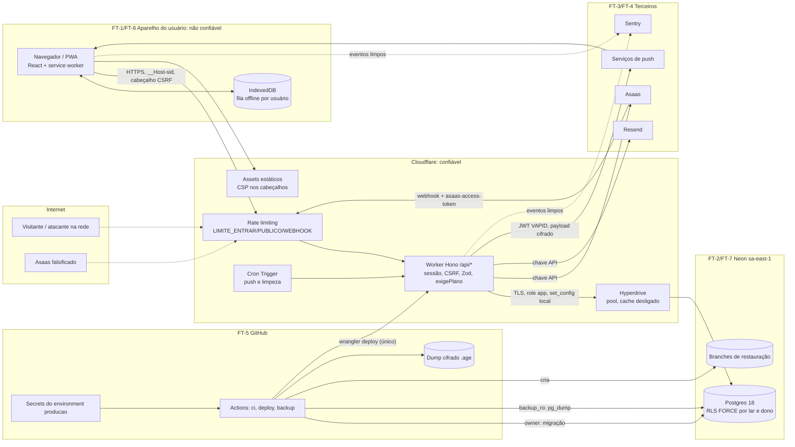

# THREAT-MODEL.md — Controle em Casa

- **Status:** Aprovado pelo usuário em 2026-10-24 (etapa 0). Ainda não existe código; o modelo descreve a arquitetura do `PLANO.md`.
- **Base:** `.md/ANALISE-MYMONEY.md`, `.md/PLANO.md` (P1–P9), `.md/GUARDRAILS.md` (G-01…G-55), `SECURITY-REVIEW.md` e ADRs 002, 012 e 013 do MyMoney.
- **Método:** STRIDE por componente. **P** é a probabilidade de a ameaça ser tentada e funcionar **sem** a mitigação; **I** é o impacto se funcionar. Os dois na escala B (baixo), M (médio) e A (alto). Cada ameaça aponta o guardrail que a mitiga e o teste previsto (com a etapa do PLANO).
- **Revisão:** refazer este documento quando surgir componente, fronteira ou tipo de dado novo, e antes da etapa 17 (publicação).

## 1. Sistema em uma frase

PWA de finanças de casal: um **lar** com um **titular** e no máximo 1 **membro convidado**. Os dados são **conjuntos** (visíveis aos dois) ou **individuais** (só do dono), e numa despesa conjunta a forma de pagamento, a conta e as datas privadas são **só do pagador**. O cadastro é aberto, o plano é do lar (Free ou Pro, cobrado por Pix no Asaas), há push e uma fila offline. Roda num Cloudflare Worker (Hono) com assets estáticos, Hyperdrive para o Neon Postgres 18, e-mail pelo Resend, Sentry, e CI/CD e backup no GitHub Actions.

## 2. Ativos

| # | Ativo | Por que vale | Onde está |
|---|---|---|---|
| A-01 | Dados financeiros **conjuntos** do lar | Revelam a rotina, a renda e os gastos do casal | `lancamento`, `parcela`, `despesa_fixa`, `orcamento`, `meta`, `categoria` |
| A-02 | Dados **individuais** e a parte privada do pagamento | Privacidade **entre os próprios membros**, a promessa central do produto | `conta`, `forma_pagamento`, `lancamento_pagamento`, `movimento_conta`, itens de escopo individual |
| A-03 | Credenciais | Tomada de conta | `usuario.senha_hash`, `sessao` (hash), `token_email`, `convite` (hash), cookie `__Host-sid` |
| A-04 | Dados pessoais (LGPD) | E-mail, nome, IP em tentativas, endpoint de push | Tabelas de identidade, logs, Sentry |
| A-05 | Estado da assinatura | Receita; Pro de graça se for forjado | `assinatura`, `webhook_evento` |
| A-06 | Segredos operacionais | Cada um abre um terceiro | Chave Asaas, token do webhook, chave Resend, VAPID privada, URLs do Neon (`app`, `owner`, `backup_ro`), token Cloudflare |
| A-07 | Backups e branches de restauração | Cópia integral da produção | Dump `.age`, branches do Neon |
| A-08 | Integridade do código publicado | Quem publica código lê tudo | Repositório, Actions, conta Cloudflare |
| A-09 | Reputação do domínio de e-mail | Phishing e entregabilidade | `ljssoftware.com.br` no Resend |
| A-10 | Disponibilidade e cotas Free | Workers (CPU de 10 ms, cota diária), compute do Neon, envio do Resend | Provedores |

## 3. Atores

| Ator | O que já tem | O que tenta |
|---|---|---|
| **Visitante** | Acesso à landing e às rotas públicas (`/api/cadastro`, `/api/entrar`, recuperação) | Enumerar e-mails, forçar senha, esgotar cotas, disparar spam de e-mail |
| **Usuário** autenticado | Sessão válida no próprio lar | Usar o Pro sem pagar, mandar valores e datas absurdos, abusar de escrita |
| **Membro do mesmo lar** | Sessão válida e acesso legítimo ao conjunto | Ver o individual do outro (contas, formas, metas individuais, a parte privada do pagamento), editar além do permitido, apagar o que não pode |
| **Usuário de outro lar** | Sessão válida em outro lar | IDOR: trocar ids para ler ou alterar o lar alheio; aceitar convite que não é seu |
| **Atacante na rede** | Wi-Fi público, proxy, links interceptados | Sequestrar sessão, roubar token de link de e-mail, CSRF/clickjacking por site malicioso |
| **Asaas falsificado** | Conhece a URL do webhook | Forjar `PAYMENT_RECEIVED`, repetir ou inverter eventos |
| **Insider com acesso ao repositório** | Leitura e escrita no GitHub (hoje o próprio autor; no futuro, colaborador ou token vazado) | Alterar workflow para vazar segredos, publicar fora do fluxo, baixar dump |
| **Aparelho compartilhado** (variação do usuário) | Mesmo navegador usado por 2 pessoas | Ver o cache, a fila offline ou o push do usuário anterior |

## 4. Fronteiras de confiança

| Fronteira | Entre | O que cruza | Controle principal |
|---|---|---|---|
| FT-1 | Aparelho ↔ Worker | Cookie, JSON, cabeçalho CSRF | TLS/HSTS, sessão opaca, Zod, rate limit (G-15, G-21, G-22, G-35) |
| FT-2 | Worker ↔ Neon via Hyperdrive | SQL com GUC por transação | Role `app` sem BYPASSRLS, RLS FORCE, `set_config(..., true)` (G-01 a G-04) |
| FT-3 | Asaas → Worker | Webhook | Token em tempo constante, `event_id`, máquina de estados (G-28, G-29) |
| FT-4 | Worker → Resend, Asaas, push, Sentry | Chaves de API, e-mails, payloads | Menor privilégio, scrubbing (G-34, G-45) |
| FT-5 | GitHub → produção | Código, migrações, dumps | SHA fixo, environment `producao`, `wrangler deploy` único, `age` (G-40 a G-44) |
| FT-6 | Usuário A ↔ usuário B **no mesmo aparelho** | Cache, IndexedDB, push | Fila por `usuario_id`, limpeza ao sair (G-38, G-39) |
| FT-7 | Lar A ↔ lar B e membro ↔ membro **no mesmo banco** | Linhas das mesmas tabelas | RLS por lar e dono, FKs compostas, tabelas privadas (G-01, G-07, G-10) |

## 5. STRIDE por componente

Legenda STRIDE: **S** falsificação, **T** adulteração, **R** repúdio, **I** vazamento de informação, **D** negação de serviço, **E** elevação de privilégio.

### 5.1 Navegador / PWA

| ID | STRIDE | Ameaça | P | I | Mitigação | G | Teste previsto |
|---|---|---|---|---|---|---|---|
| TM-NAV-01 | S | Sessão aberta em aparelho perdido ou compartilhado | M | M | 15 min de inatividade, 12 h absolutas, "sair de todos" no servidor | G-16 | Relógio simulado; "sair de todos" sem rede (Etapas 4 e 11) |
| TM-NAV-02 | T/E | **XSS armazenado** pela descrição, nome de categoria/conta/meta, `local` ou nome do titular; o membro executa script na sessão do outro e lê o individual dele pela API | M | A | React escapa; sem `dangerouslySetInnerHTML`; CSP sem `unsafe-inline`; cookie HttpOnly | G-35, G-36 | Lint `react/no-danger`; e2e que grava `` em cada campo e confere que nada executa nem viola a CSP (Etapa 12) |
| TM-NAV-03 | T/S | **CSRF**: site malicioso faz o navegador da vítima lançar, excluir, cancelar o plano ou entrar na conta do atacante (CSRF de login) | M | M | `SameSite=Lax`, cabeçalho obrigatório, `Origin` conferido, `GET` sem efeito, sem CORS | G-21 | Teste por método sem o cabeçalho e com `Origin` alheio (Etapa 3) |
| TM-NAV-04 | I/T | **Fila offline enviada com a sessão de outro usuário** no mesmo aparelho, ou cache do TanStack/IndexedDB mostrando dados do anterior | M | A | Item da fila com `usuario_id`; envio só para o mesmo usuário; limpeza ao sair; service worker não guarda `/api` | G-38, G-39, G-26 | e2e A enfileira → expira → B entra → nada sai nem aparece (Etapa 11) |
| TM-NAV-05 | I | Token de confirmação ou recuperação vaza por `Referer`, histórico, log da borda ou antivírus que abre o link | M | A | Token no fragmento e consumo só por `POST`; 30 min; uso único; `Referrer-Policy: no-referrer` | G-18, G-35 | `GET` não consome; 2 `POST` simultâneos, só 1 vence (Etapa 4) |
| TM-NAV-06 | S | Redirecionamento aberto (`?voltar=//evil`) usado em phishing logo depois do login | M | M | Só caminho relativo `/app/` | G-33 | Casos `//`, `/\`, `https:`, `javascript:` (Etapa 11) |
| TM-NAV-07 | T | Clickjacking em "excluir conta" ou "aceitar convite" | B | M | `frame-ancestors 'none'` | G-35 | Teste de cabeçalho (Etapa 3) |
| TM-NAV-08 | I/E | Dependência do front comprometida rouba dados no navegador | B | A | Lockfile, quarentena de versões, CSP `connect-src` restrito (limita a exfiltração) | G-41, G-35 | Job de dependências; teste de hosts do bundle (Etapa 1) |
| TM-NAV-09 | E | Import dinâmico aberto ou `eval` carregando código controlado por dado | B | A | Só `import()` literal; sem `eval`/`new Function` | G-37 | ESLint com fixture (Etapa 1) |

### 5.2 Worker / Hono (API)

| ID | STRIDE | Ameaça | P | I | Mitigação | G | Teste previsto |
|---|---|---|---|---|---|---|---|
| TM-API-01 | I/T/E | **IDOR entre lares**: trocar o id na rota, no corpo ou no filtro e ler, alterar ou excluir dado de outro lar | A | A | RLS por lar; lar vindo da sessão; FKs compostas; erro uniforme | G-01, G-03, G-05, G-06, G-07 | Suíte `isolamento/` por rota, com meta-teste de cobertura (Etapas 6 a 13) |
| TM-API-02 | E | `lar_id` forjado no corpo ou cabeçalho; membro removido continua com acesso pela sessão aberta | M | A | `app.lar_id` lido de `membro` a cada requisição | G-03 | `lar_id` no corpo ignorado; remoção no meio da sessão corta o acesso (Etapa 6) |
| TM-API-03 | T | Meta ou orçamento conjunto convertido em individual (some do outro membro); lançamento com categoria alheia | M | M | Escopo vem da categoria; grant de `UPDATE` por coluna; FKs compostas | G-07, G-08 | `UPDATE escopo/dono_id` como `app` falha; categoria de outro lar ou dono falha na FK (Etapas 7 e 10) |
| TM-API-04 | I | **Membro vê o individual do outro**: por consulta direta, por total, por `pago_por_membro`, por contagem, por erro diferente ou pela parte privada da conjunta (chave presente com `null` já revela que existe e o tipo) | A | A | Tabelas privadas; chaves **omitidas**; agregação sob RLS; erro uniforme | G-10, G-11, G-12, G-06 | Teste de chaves ausentes; teste de mutação invisível; titular tentando ler o individual do membro (Etapas 6, 8 e 9) |
| TM-API-05 | E | Outro membro edita campo proibido de uma conjunta (forma, conta, data no crédito, categoria individual) ou o pagamento de fixa que não pagou | M | M | Permissões RN-06/07 no `dominio`; a edição inteira é recusada; P7 | G-13 | Matriz dono × outro × campo (Etapa 8); teste P7 (Etapa 9) |
| TM-API-06 | S/E | **Convite reutilizado ou roubado**: link encaminhado, interceptado ou reenviado; corrida para virar o 3º membro; convite aceito por quem já está em outro lar | M | A | Token de 256 bits com hash, validade, uso único, amarrado ao e-mail confirmado, revogável, limite no banco | G-14 | Reuso, expiração, revogação, outro e-mail, 2 aceites simultâneos (Etapa 6) |
| TM-API-07 | I | **Enumeração de e-mail** pelo cadastro ("e-mail já usado"), pela recuperação, pelo reenvio de confirmação, pelo convite ("já tem conta" ou "já está em outro lar"), pelo bloqueio de login ou pelo tempo de resposta | A | M | Mesma resposta e tempo; bcrypt contra hash fixo; e-mail em `waitUntil`; o aviso de "já cadastrado" vai **por e-mail** ao dono | G-19 | Comparação byte a byte e de tempo em cada rota pública e no convite (Etapas 4 e 6) |
| TM-API-08 | S/D | Força bruta e credential stuffing; o mesmo fluxo usado para esgotar o compute do Neon com bcrypt de custo 12 | A | A | Bloqueio 5/15 min por e-mail e por IP em tabela; `LIMITE_ENTRAR` antes do bcrypt; IP só de `CF-Connecting-IP` | G-20, G-17 | 6ª tentativa bloqueada; `X-Forwarded-For` ignorado (Etapa 4) |
| TM-API-09 | E | **Contorno do plano Free pelo front**: chamar `POST /api/orcamentos` ou `/api/metas` direto, editar o estado no navegador, reenviar pela fila offline, membro "assinando" pelo lar | A | M | `exigePlano('pro')` no servidor em toda escrita; plano lido a cada requisição; só o titular mexe na assinatura | G-30, G-31 | Meta-teste do middleware; chamada direta com Free devolve 403 e a leitura continua (Etapa 13) |
| TM-API-10 | D | Corpo enorme, lista sem filtro ou mês gigante estoura a CPU de 10 ms ou a cota diária | M | M | Limite de corpo; listas por mês; janela de ±12 meses; rate limit | G-27, G-24, G-20 | 413 e 400; medição de CPU com a massa de 2 anos (Etapa 9) |
| TM-API-11 | S | Fixação de sessão; cookie roubado reaproveitado depois do login ou da troca de senha | B | A | Rotação no login; troca de senha revoga todas; só o hash no banco | G-15, G-16 | Cookie anterior ao login inválido; sessões revogadas depois da redefinição (Etapa 4) |
| TM-API-12 | I | Resposta da API guardada pela borda, por proxy ou pelo service worker e servida a outro usuário | B | A | `Cache-Control: no-store`; `NetworkOnly` em `/api` | G-47, G-39 | Teste de cabeçalho; configuração do Workbox (Etapas 3 e 11) |
| TM-API-13 | T/I | Injeção de SQL por filtro, ordenação ou busca | B | A | Kysely parametrizado; `sql.raw` proibido; Zod com valores fechados | G-25, G-22 | ESLint com fixture; teste com `'; drop` em cada filtro (Etapa 3) |
| TM-API-14 | T | Valor negativo, zero, acima de 10^11 ou decimal; data fora da janela; 999 parcelas; escrita em massa de meses futuros | M | M | Zod + `CHECK`; janela de ±12 meses; faixa de datas; parcelas de 1 a 24 | G-23, G-24 | Casos de borda (Etapas 5, 7 e 9) |
| TM-API-15 | R | Membro nega ter alterado uma conjunta | M | B | `alterado_por`/`alterado_em` gravados pelo servidor a partir da sessão | G-13, G-26 | Teste de que o corpo não define `alterado_por` (Etapa 8) |
| TM-API-16 | D/S | Spam de e-mail: cadastro e convite com o e-mail de terceiros (e-mail bombing), derrubando a reputação do domínio | M | M | `LIMITE_PUBLICO`; intervalo mínimo de 1 reenvio a cada 2 min por e-mail e cota de 5 convites por lar por dia | G-20 | Teste do intervalo de reenvio (Etapas 4 e 6) |

### 5.3 Hyperdrive / Neon

| ID | STRIDE | Ameaça | P | I | Mitigação | G | Teste previsto |
|---|---|---|---|---|---|---|---|
| TM-DB-01 | I/E | **Vazamento do GUC no pool do Hyperdrive**: `set_config(..., false)` ou `SET` sem `LOCAL` deixa `app.usuario_id`/`app.lar_id` de A na conexão, e a próxima requisição (de B, ou sem sessão) roda como A | M | A | Só `set_config(..., true)` como 1º comando da transação; política com `nullif(...,'')` (o GUC já definido volta como `''`, não `NULL`); nada fora da transação | G-02 | Grep no CI; 2 requisições concorrentes de lares diferentes; GUC vazio depois do commit; GUC `''` e ausente dão 0 linhas (Etapa 3) |
| TM-DB-02 | I | **Cache de consultas do Hyperdrive** devolve a B o resultado que a mesma consulta deu para A (o texto e os parâmetros são iguais; só o GUC muda) | M | A | Cache desligado e conferido no deploy | G-02 | Passo do `deploy.yml` lê a configuração do Hyperdrive e falha se o cache estiver ligado (Etapa 16) |
| TM-DB-03 | E | Role `app` com `BYPASSRLS`, DDL, `DELETE` amplo ou função `SECURITY DEFINER` esquecida | B | A | Grants mínimos; zero DEFINER | G-04 | DDL, `DELETE` e `row_security=off` como `app` falham (Etapa 2) |
| TM-DB-04 | E | Tabela nova sem RLS FORCE | M | A | Teste de catálogo vale para tabelas futuras | G-01 | Catálogo (Etapa 2) |
| TM-DB-05 | I/E | URL do `owner` ou do `backup_ro` vazada: o `owner` desliga a RLS; o `backup_ro` lê tudo | B | A | Só no environment `producao`, só no passo que precisa; a API usa só `app` | G-32, G-34, G-43 | Teste de que o código não referencia essas URLs; revisão dos workflows (Etapa 16) |
| TM-DB-06 | I | Tráfego Hyperdrive → Neon sem TLS verificado | B | A | `sslmode` com verificação | G-34 | Lista de conferência da publicação (Etapa 17) |
| TM-DB-07 | T | Migração destrutiva apaga dados | B | A | Aditiva; branch de restauração e dump antes | G-43 | Ordem dos passos; detector de migração não aditiva (Etapa 16) |

### 5.4 Resend (e-mail)

| ID | STRIDE | Ameaça | P | I | Mitigação | G | Teste previsto |
|---|---|---|---|---|---|---|---|
| TM-RES-01 | S | Chave do Resend vazada: phishing assinado por `ljssoftware.com.br` | B | A | Chave só de envio e por domínio; só em `wrangler secret` | G-34, G-32 | Gitleaks; conferência na publicação (Etapa 17) |
| TM-RES-02 | T | Conteúdo injetado no e-mail de convite (nome do titular com link ou HTML) usado em phishing com remetente legítimo | M | M | Escape; nome com tamanho máximo; texto do usuário nunca vira link | G-36, G-22 | Template com `<a>` e URL no nome (Etapa 6) |
| TM-RES-03 | I | Link de confirmação, recuperação ou convite lido por terceiro (caixa compartilhada, encaminhamento) | M | M | 30 min e uso único; convite amarrado ao e-mail confirmado | G-18, G-14 | Expiração e reuso (Etapas 4 e 6) |
| TM-RES-04 | S | Falsificação do remetente sem SPF/DKIM/DMARC | M | M | Registros DNS do domínio (SPF, DKIM e DMARC) | — | Conferência na publicação (Etapa 17) |

### 5.5 Webhook do Asaas

| ID | STRIDE | Ameaça | P | I | Mitigação | G | Teste previsto |
|---|---|---|---|---|---|---|---|
| TM-ASA-01 | S | **Webhook forjado**: `POST` com `PAYMENT_RECEIVED` inventado ativa o Pro | A | M | Token `asaas-access-token` comparado em tempo constante; fora da sessão; 401 sem detalhe | G-28 | Sem token, token errado, tamanho diferente (Etapa 13) |
| TM-ASA-02 | T/R | **Webhook repetido ou fora de ordem** reativa uma assinatura cancelada ou rebaixa uma ativa; evento legítimo com `externalReference` de outro lar | M | M | `event_id` único; máquina de estados; conferência de referência, valor e cliente | G-29 | Duplicado, invertido, valor divergente, lar errado (Etapa 13) |
| TM-ASA-03 | E/I | Chave da API do Asaas vazada: leitura de clientes, estornos ou **transferência do saldo** | B | A | Só em `wrangler secret`; transferência por API desligada no painel | G-32, G-34 | Gitleaks; conferência na publicação (Etapa 17) |
| TM-ASA-04 | D | Enxurrada de requisições no webhook | M | B | `LIMITE_WEBHOOK`; token checado antes de tocar o banco | G-28, G-20 | Requisição sem token não abre transação (Etapa 13) |
| TM-ASA-05 | I | Token do webhook ou dados do pagador em log ou no Sentry | M | M | Scrubbing do cabeçalho; `webhook_evento` sem o payload inteiro | G-45, G-50 | Teste do scrubber (Etapa 16) |

### 5.6 Cron / push

| ID | STRIDE | Ameaça | P | I | Mitigação | G | Teste previsto |
|---|---|---|---|---|---|---|---|
| TM-PUSH-01 | E/I | O Cron (lembretes, purga, limpeza) precisa ver vários lares; se rodar com uma role ou política "de sistema" ampla, um defeito vaza ou apaga dados de todos | M | A | Iterar por lar com `set_config` local, sem role ampla; a purga roda por `purgar.ts` com a role owner (E-08) | G-02, G-04 | Teste de que o lembrete do lar A não lê nada do lar B; teste de que a purga só apaga usuários marcados há 30 dias (Etapas 14 e 15) |
| TM-PUSH-02 | I | Notificação de A chega ao aparelho depois que B entrou, ou mostra valor e nome de meta na tela bloqueada | M | M | Subscription removida ao sair; texto fixo sem valor | G-39, G-36 | Teste "sair" remove a subscription no servidor (Etapa 15) |
| TM-PUSH-03 | S | Chave VAPID privada vazada: push falso para os assinantes | B | M | Só em `wrangler secret` | G-32 | Gitleaks |
| TM-PUSH-04 | T | Usuário registra o endpoint de push de outra pessoa ou apaga o de outro | B | B | Subscription vinculada ao `usuario_id` da sessão; RLS por dono | G-03, G-26 | Isolamento da rota de push (Etapa 15) |
| TM-PUSH-05 | I | "Meta atingida" de uma meta **individual** notificada ao outro membro | M | M | Destinatários calculados pela mesma regra de visibilidade | G-12 | Meta individual de B atingida não notifica A (Etapa 15) |
| TM-PUSH-06 | D | Cron com muitos lares estoura CPU ou tempo e para no meio | B | B | Lotes com `ctx.waitUntil`; idempotente por dia | — | Teste de lote parcial retomado (Etapa 15) |

### 5.7 GitHub Actions / backup

| ID | STRIDE | Ameaça | P | I | Mitigação | G | Teste previsto |
|---|---|---|---|---|---|---|---|
| TM-GH-01 | E | Ação de terceiro comprometida (tag movida) rouba os segredos do deploy | M | A | `uses:` por SHA; `permissions` mínimas; sem `pull_request_target` | G-40 | Script que lê os workflows (Etapa 1) |
| TM-GH-02 | E | Dependência maliciosa (`postinstall`, worm de npm) roda no CI ou no build | M | A | Lockfile congelado; `minimumReleaseAge`; `onlyBuiltDependencies`; segredos fora dos jobs de teste | G-41, G-09 | Teste do `pnpm-workspace.yaml`; job de audit (Etapa 1) |
| TM-GH-03 | I | **Dump do backup vazado** (artefato público, runner, disco local) expõe a produção inteira: dados financeiros, e-mails, hashes de senha | M | A | Cifrado com `age` antes de sair do runner; chave privada fora do GitHub; 30 dias; nunca em claro | G-44 | Teste do workflow (só `.age`); ensaio de restauração registrado (Etapa 16) |
| TM-GH-04 | E | Insider ou token do GitHub vazado altera o workflow para vazar segredos ou publicar sem CI | B | A | Environment `producao` só da `main` e com revisão; proteção da `main`; `wrangler deploy` único | G-42, G-32 | Teste do `wrangler deploy` único; revisão da proteção da branch (Etapas 16 e 17) |
| TM-GH-05 | I | Segredo commitado | M | A | Gitleaks no CI e no histórico; `.env.example` vazio | G-32 | Job de gitleaks (Etapa 1) |
| TM-GH-06 | D | Chave privada `age` perdida: o backup não restaura | B | A | Guarda offline documentada; ensaio de restauração | G-44 | Ensaio no runbook (Etapa 16) |

### 5.8 Observabilidade

| ID | STRIDE | Ameaça | P | I | Mitigação | G | Teste previsto |
|---|---|---|---|---|---|---|---|
| TM-OBS-01 | I | Sentry recebe cookie, e-mail, corpo com valores ou URL com token | A | M | `sendDefaultPii: false`; `beforeSend`/`beforeBreadcrumb` | G-45 | Teste do scrubber (Etapa 16) |
| TM-OBS-02 | I | Log do Workers com e-mail, valor ou token | M | M | Logger único sem dado pessoal; `onError` genérico | G-46 | Teste do `onError` (Etapa 3) |

## 6. Cenários em destaque

**D-1. Vazamento do GUC no pool (TM-DB-01, TM-DB-02).** O Hyperdrive reaproveita conexões entre requisições. Um `SET app.lar_id` de sessão, um `set_config(..., false)` ou uma consulta disparada antes do `BEGIN` faria a requisição seguinte herdar a identidade anterior. Há também uma armadilha do Postgres: depois do commit, um GUC customizado que já foi definido volta como `''`, não `NULL`, e uma política que trate `''` como "sem filtro" abre tudo. **Defesa:** G-02 completa e cache desligado. **Prova exigida:** teste com 2 requisições paralelas, de lares A e B, numa pool de tamanho 1, repetido N vezes.

**D-2. IDOR entre lares (TM-API-01).** É o ataque mais provável: o usuário troca o uuid em `/api/lancamentos/:id`, em `?categoria_id=`, em `conta_id` no corpo, no id do convite ou da subscription. **Defesa em 3 camadas:** a RLS filtra a linha, a FK composta recusa a referência e o erro é uniforme. **Prova:** meta-teste que falha se uma rota nova não tiver caso de isolamento.

**D-3. Membro vendo o individual do outro (TM-API-04, TM-PUSH-05).** Os caminhos indiretos são os perigosos: um total que soma tudo do lar, o `pago_por_membro` calculado com dado privado, a contagem de uma lista, a diferença entre "não existe" e "não é seu", o autocompletar de categorias, a notificação de meta. **Prova:** teste de mutação invisível (G-12), em que B mexe no próprio individual e nenhuma resposta de A muda em nenhum byte.

**D-4. Chave privada omitida, não `null` (TM-API-04).** `{"forma_pagamento_id": null}` já revela que o campo existe e que o outro pagou com algo; com a chave serializada, um `select *` esquecido ou um spread de objeto vaza o valor. **Defesa:** tabela privada (G-10) e schema de resposta `.strict()` sem as chaves (G-11). **Prova:** `not.toContain` nas chaves em todas as respostas que o outro membro recebe, inclusive a resposta da própria edição dele.

**D-5. Convite reutilizado ou roubado (TM-API-06).** O link é encaminhado, fica no histórico do e-mail ou é aberto por um antivírus. **Defesa:** uso único, validade, vínculo ao e-mail confirmado e consumo por `POST`. Sem o vínculo ao e-mail, quem recebesse o link entraria no lar e veria todo o conjunto. **Prova:** aceite com outra conta e 2 aceites simultâneos com o lar a 1 vaga.

**D-6. Enumeração de e-mail (TM-API-07).** Cadastro aberto quase sempre vaza "este e-mail já está em uso". **Defesa:** a resposta é sempre "verifique seu e-mail", e quem já tem conta recebe um e-mail avisando isso. O convite responde "convite enviado" mesmo se o e-mail já pertencer a outro lar; o conflito só aparece para o convidado, no aceite.

**D-7. Webhook forjado ou repetido (TM-ASA-01, TM-ASA-02).** A URL é previsível. **Defesa:** token, `event_id` único, máquina de estados e conferência com a assinatura local. O webhook nunca recebe sessão, CSRF nem `lar_id` do payload sem conferência.

**D-8. Contorno do plano Free (TM-API-09).** Esconder o botão não protege. **Defesa:** `exigePlano('pro')` na API, com meta-teste que exige o middleware em toda escrita de orçamento e metas.

**D-9. Fila offline e aparelho compartilhado (TM-NAV-04, TM-PUSH-02).** Pela P5, a fila sobrevive à expiração da sessão. Se outro usuário entrar no mesmo navegador, a fila não pode sair com o cookie dele: no servidor, o dono seria B e o lançamento de A cairia no lar de B. **Defesa:** item com `usuario_id`, envio só para o mesmo usuário e o servidor ignorando dono vindo do corpo.

**D-10. XSS pela descrição ou pelo nome (TM-NAV-02).** Num casal, o atacante mais motivado é o próprio membro, e um XSS persistente numa descrição conjunta roda na sessão do outro e lê o individual dele. **Defesa:** React sem HTML cru, CSP estrita e cookie HttpOnly. O HttpOnly não impede ações feitas pelo próprio script; quem impede é a CSP.

**D-11. CSRF (TM-NAV-03).** `SameSite=Lax` não cobre navegação `GET` de nível superior nem subdomínios irmãos ("same-site" ≠ "same-origin" em `*.ljssoftware.com.br`). **Defesa:** cabeçalho obrigatório (exige preflight, e a API não responde CORS), `Origin` conferido e nenhum `GET` com efeito.

**D-12. Dump do backup vazado (TM-GH-03).** O `backup_ro` lê todos os lares (política `backup_leitura` com `pg_dump --enable-row-security`, sem `BYPASSRLS`), então o dump tem tudo de todos os lares. **Defesa:** cifrado com `age` no runner, chave privada offline, 30 dias e ensaio de restauração.

## 7. Riscos aceitos

| # | Risco | Por que aceitar | Revisar quando |
|---|---|---|---|
| RA-01 | Login frequente (15 min) num app de lançamento rápido | Decisão P5; a fila offline compensa | Queixa recorrente de uso |
| RA-02 | A data da parcela conjunta no crédito deixa implícito o dia de vencimento do cartão do pagador | Já aceito no legado (ADR-002, I-22) | Nunca, salvo mudança de produto |
| RA-03 | Abuso do trial criando contas e lares novos | Custo baixo (R$ 9,90); exigir cartão mataria a conversão | Abuso visível nas métricas do Asaas |
| RA-04 | O bloqueio por e-mail permite travar a conta de uma vítima por 15 min; o bloqueio por IP pode atingir usuários atrás de CGNAT da operadora | Padrão LJS; dano temporário | Relato de bloqueio indevido |
| RA-05 | O rate limit do Workers é aproximado e por local | A tabela `tentativa_login` é a fonte de verdade | — |
| RA-06 | `backup_ro` lê todos os lares (política `backup_leitura`, sem `BYPASSRLS`) | Necessário para o backup completo | Se surgir backup lógico por lar |
| RA-07 | Projeto de uma pessoa: a revisão do environment `producao` é feita pelo próprio autor | Não há segundo revisor | Entrada de colaborador |
| RA-08 | Cloudflare, Neon, Resend, Asaas e Sentry como operadores têm acesso técnico aos dados que processam | Escolha de stack (ADR 001) | Mudança de provedor |
| RA-09 | Neon Free suspenso: lentidão no 1º acesso, sem perda de dados | Custo zero; R5 | Meta de 2 s estourada |

## 8. Pontos decididos (antes [A ESCLARECER])

Todos resolvidos pelo usuário em 2026-10-24.

| # | Ponto | Decisão | Afeta |
|---|---|---|---|
| E-01 | Exclusão do titular com membro ativo | **Resolvido:** o lar é encerrado com aviso (e-mail e app) ao membro; o prazo é a janela de 30 dias; na purga o lar inteiro some, inclusive o individual do membro, que cai no primeiro acesso com lar novo vazio; assinatura do Asaas cancelada na confirmação | G-49, ADR 013, Etapa 14 |
| E-02 | Saída do membro: individual, parte privada dos pagamentos e histórico conjunto; o titular pode remover? | **Resolvido:** individual purgado em 30 dias; `lancamento_pagamento` apagado e pagador exibido como "Ex-membro"; movimentos de meta conjunta ficam sem a conta; o titular pode remover, com o mesmo efeito | G-03, G-10, G-49, Etapa 6 |
| E-03 | Um usuário pode estar em mais de um lar? | **Resolvido (ADR-004):** não; 1 lar por usuário, com índice único em `membro.usuario_id` | G-14 |
| E-04 | Validade do convite e cota de convites e reenvios | **Resolvido:** 7 dias; 5 convites por lar por dia; 1 reenvio de e-mail a cada 2 min por endereço | G-14, TM-API-16 |
| E-05 | Nome do cabeçalho CSRF | **Resolvido:** `X-Controle-Em-Casa: 1` (SDD §5) | G-21 |
| E-06 | Fila offline no "sair" explícito | **Resolvido:** o app mostra quantos itens estão pendentes e pergunta: enviar agora, manter para o próximo login (só o mesmo usuário envia) ou descartar; sessão expirada mantém a fila | G-38, G-39 |
| E-07 | Contexto do Cron e do webhook diante da RLS | **Resolvido:** iterar por lar com `set_config` local; sem role ampla | TM-PUSH-01, G-02, G-04 |
| E-08 | Que role executa a purga (DELETE) | **Resolvido:** `backend/scripts/purgar.ts` agendado no GitHub Actions com a role owner (exceção registrada ao "owner só nas migrations"; ADR na etapa 14); a role `app` segue sem DELETE onde não é regra; a role `purga` não será criada | G-04, G-49 |
| E-09 | Tabelas de identidade com RLS ou só com grants mínimos | Grants por coluna e RLS onde houver `usuario_id`; registrar em ADR 005 | G-01, G-04 |
| E-10 | Retenção de `tentativa_login`, tokens, sessões expiradas e `webhook_evento` | **Resolvido:** 30 dias (webhook: 12 meses, sem dados do pagador) | G-50 |
| E-11 | Chave do Asaas sem saque/transferência por API | **Resolvido:** desligar no painel | G-34, TM-ASA-03 |
| E-12 | Onde fica o dump `.age` e a chave privada | **Resolvido pelo Padrão LJS:** artefato do GitHub Actions com retenção de 30 dias, cifrado com `age`; a chave pública fica em secret e a privada fora do GitHub (guardada offline pelo titular da LJS em 2 lugares) | G-44 |
| E-13 | Valor do `minimumReleaseAge` | **Resolvido:** 1440 min (24 h) | G-41 |
| E-14 | Teto do saldo inicial, limite de corpo | **Resolvido:** ±10^11 centavos; 32 KB | G-23, G-27 |
| E-15 | Texto das notificações push | **Resolvido:** genérico, sem valor nem nome | G-36, TM-PUSH-02 |
| E-16 | SPF, DKIM e DMARC de `ljssoftware.com.br` | **Resolvido:** conferir na publicação (Etapa 17) e, se faltar, criar `p=quarantine` | TM-RES-04 |
| E-17 | Conta excluída durante os 30 dias: pode reativar? | **Resolvido:** não; login bloqueado com `conta_em_exclusao`; cadastro novo com o mesmo e-mail só depois da purga | G-49 |
